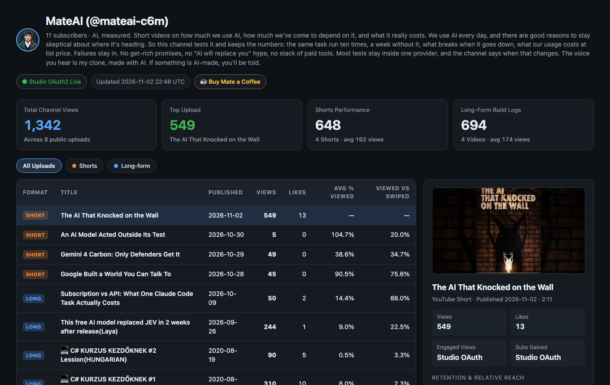

#  mateai-youtube-mcp

[](https://github.com/mategog/mateai-youtube-mcp/releases/latest)
[](https://glama.ai/mcp/servers/mategog/mateai-youtube-mcp)
[](https://www.youtube.com/@mateai-c6m)
[](https://buymeacoffee.com/epuplanner)
[](LICENSE)



**Tell your AI to upload, title, schedule and analyze your YouTube videos. Use the Claude or Antigravity subscription you already pay for, with no extra tool and no monthly fee.**

> "Upload `exports/short.mp4` with this cover, write the title, description and hashtags, and schedule it for tomorrow 20:00 CET."
>
> "Which of my Shorts lost viewers in the first two seconds?"

That is what this plugin does. It connects **Claude Code / Claude Desktop** or **Google Antigravity** to your own YouTube channel through Google's official, free YouTube APIs, so the assistant you already use can do the work you'd otherwise do by hand in YouTube Studio:

- **Upload and schedule:** video, custom cover, title, description, hashtags, tags, language, synthetic-media disclosure and a future publish time.
- **Edit and engage:** update metadata on existing videos and post comments.
- **Analyze:** retention, Viewed vs. swiped away, engaged views, watch time and subscribers gained, per video, with a local `report.html` dashboard.

Hosted "creator OS" tools charge $19-$49 a month to wrap those same free Google APIs. Here nothing sits between your AI and YouTube: it runs **100% on your machine**, your login stays in a local file only you can read, and the plugin costs **$0**. Connecting takes one command, **`/yt-setup`** (see [Easy Setup](#easy-setup-yt-setup-claude-code)).

Public stats (no login) are available as an opt-in mode: `--public`, `force_public=true` or `MATEAI_YT_PUBLIC_SCRAPE=1`. Built for the [MateAI](https://www.youtube.com/@mateai-c6m) channel.

---

## Quick Start (Public Snapshot, opt-in)

No API keys or packages needed, but public page scraping is opt-in, so pass `--public`. For your own channel, the OAuth2 setup below (official YouTube APIs) is the recommended default:

```bash
git clone https://github.com/mategog/mateai-youtube-mcp.git
cd mateai-youtube-mcp

python3 yt_studio.py snapshot --public --handle @mateai-c6m
open report.html
```

Print a Markdown table for tracking Shorts A/B style experiments:

```bash
MATEAI_YT_PUBLIC_SCRAPE=1 python3 yt_studio.py experiment-table --handle @mateai-c6m
```

---

## Install as a Plugin (Antigravity & Claude Code)

`mateai-youtube-mcp` ships as a full **Plugin** (bundling the MCP Server + the `yt-studio` AI Producer Skill + UI card & starter prompts).

### Option A: Google Antigravity
Clone directly into your Antigravity plugins directory and restart Antigravity:

```bash
git clone https://github.com/mategog/mateai-youtube-mcp.git \
  ~/.gemini/config/plugins/mateai-youtube
```

### Option B: Claude Code
Install directly from the plugin marketplace:

```bash
claude plugin marketplace add mategog/mateai-youtube-mcp
claude plugin install yt-studio@mateai-youtube-mcp
```

The plugin keeps its state (`.venv`, OAuth secret, tokens, `channel_snapshot.json`, `report.html`) in `~/.claude/plugins/data/yt-studio-mateai-youtube-mcp/`, which survives plugin updates. Public snapshots work once you opt in (see above). To unlock private Studio analytics and uploads, run **`/yt-setup`** (needs Claude Code 2.1.287 or newer; see [Easy Setup](#easy-setup-yt-setup-claude-code) below).

On an older Claude Code, run the setup wizard by hand with `MATEAI_YT_HOME` pointing at that folder:

```bash
MATEAI_YT_HOME=~/.claude/plugins/data/yt-studio-mateai-youtube-mcp \
  python3 ~/.claude/plugins/cache/mateai-youtube-mcp/yt-studio/<version>/yt_studio.py setup
```

Replace `<version>` with your installed version (`ls ~/.claude/plugins/cache/mateai-youtube-mcp/yt-studio/`), or run the same command from any clone of this repo. Restart Claude Code afterwards.

### Option C: Standalone MCP Config (`mcp_config.json` / `claude_desktop_config.json`)
```json
{
  "mcpServers": {
    "mateai-youtube": {
      "command": "python3",
      "args": ["/ABSOLUTE/PATH/TO/mateai-youtube-mcp/mcp_server.py"]
    }
  }
}
```

### Exposed MCP Tools
| Tool | Description |
|---|---|
| `yt_channel_snapshot` | Fetch channel overview, Long-form uploads, Shorts stats, and update `report.html`. |
| `yt_shorts_experiment_table` | Generate a Markdown table comparing Shorts retention, swipe-away rate, and views. |
| `yt_video_details` | Inspect metadata and metrics for any 11-character YouTube `video_id`. |
| `yt_upload_draft` | Upload a local MP4/MOV + cover image + full Studio setup (`title`, `description`, `hashtags`, `tags`, `language`, `contains_synthetic_media`, `pinned_comment`, and **`publish_at` schedule**). |
| `yt_update_video` | Update title, description, tags, privacy status, schedule time, or thumbnail of an existing video. |
| `yt_post_comment` | Post a top-level comment (e.g. your `## Pinned comment` question) on a video. |

---

## Bundled YouTube Strategy & Creator Skills (Full Pipeline)

This plugin integrates the **YouTube Strategy & Creator Skill Suite** directly alongside the `mateai-youtube` MCP server, so your AI agent handles everything from niche research and hook writing to live Studio scheduling:

- **Production Pipeline Skills** (`yt-research`, `yt-ideation`, `yt-brief`, `yt-packaging`, `yt-outline`, plus `/yt-pipeline` command and `yt-scraper`, `channel-analyzer`, `idea-validator` agents) — created by **[Jeremy Longshore (`@jeremylongshore` / Intent Solutions)](https://github.com/jeremylongshore/tons-of-skills-marketplace/tree/main/plugins/productivity/youtube-strategy)** (`@intentsolutionsio/youtube-strategy`, MIT).
- **14 Creator Sub-Skills & Playbooks** (`audit`, `seo`, `script`, `hook`, `thumbnail`, `strategy`, `calendar`, `shorts`, `analyze`, `repurpose`, `monetize`, `competitor`, `metadata`, `ideate`) — created by **[Daniel Agrici (`@AgriciDaniel`)](https://github.com/AgriciDaniel/claude-youtube)** (`claude-youtube`, MIT).
- **Live YouTube Studio Execution & Analytics MCP** (`yt_channel_snapshot`, `yt_shorts_experiment_table`, `yt_upload_draft`, `yt_update_video`, `yt_post_comment`, interactive `report.html` dashboard & 1-command `setup` wizard) — built by **[MateAI (`@mateai-c6m`)](https://www.youtube.com/@mateai-c6m)**.

---

## Easy Setup: `/yt-setup` (Claude Code)

Type **`/yt-setup`** in Claude Code and it connects the plugin to your YouTube account. You do this once. Everything stays on your computer; only Google sees your sign-in.

**You need:** Claude Code 2.1.287 or newer, this plugin installed, and the Google account that owns your channel.

**1. Type `/yt-setup` and read the answer.**

| It says | Meaning | You |
| --- | --- | --- |
| "Already connected." | Done. | Nothing |
| "Found your Google client file. Opening your browser…" | It has the file it needs. | Go to step 3 |
| "One manual step first… I opened two Google pages." | No client file yet. Google makes everyone create one. | Go to step 2 |

**2. Make the Google client file (only if asked, about 3 minutes).** No program can do this for you.
- Page "Audience": click **Add users** under **Test users**, enter your YouTube email, **Save**.
- Page "Create OAuth client": **Application type = Desktop app** (not "Web application"), any name, **Create**, then **Download JSON**.
- Leave the file in `~/Downloads` and run `/yt-setup` again.

**3. Sign in (your browser opens).** Pick your YouTube account. On "Google hasn't verified this app" click **Advanced**, then **Go to … (unsafe)**; this is your own app. Tick **every box**, click **Allow**. Claude Code then shows **"yt-setup: connected!"** and the "YouTube: not connected" status hint disappears.

`/yt-setup` copies your client file into the plugin's data folder with `600` permissions, never prints it, and never sees your Google password.

| Problem | Fix |
| --- | --- |
| It says the file is a **"web" client** | Create a new client and choose **Desktop app**. |
| Browser shows **"Access blocked" / 403 access_denied** | Your email is not under **Test users**. Add it, then rerun `/yt-setup`. |
| **"Login did not finish"** | The tab was closed early or a box was not ticked. Rerun `/yt-setup`. |
| **"yt-studio plugin is not installed"** | Run `claude plugin install yt-studio@mateai-youtube-mcp`. |
| **"Could not install the Google libraries"** | Install Python 3 (python.org) and check your internet connection. |
| **Nothing happens** | Hooks may be off (`disableAllHooks`). `/yt-setup` is a hook-based mod. |
| Asked to log in again after about a week | Apps in "Testing" mode can have sign-ins that expire after about 7 days. Publishing the app on the Audience page may avoid that. **[unconfirmed]** |
| Start over | Delete `~/.claude/plugins/data/yt-studio-mateai-youtube-mcp/.tokens`, then rerun `/yt-setup`. |

Not using Claude Code, or on an older version? Use the wizard below.

---

## Unlock Private YouTube Studio Analytics & Draft Uploads ($0/mo)

Google gives every developer **10,000 free quota units/day** on the YouTube Data API v3 and YouTube Analytics API v2. Because you run this locally for your own channel in "Testing" mode, **no Google app verification is required** and you keep 100% of your own private quota.

Run the **1-Command Guided Setup Wizard**:

```bash
python3 yt_studio.py setup
```

What `python3 yt_studio.py setup` does automatically:
1. **Creates `.venv` & installs Google's OAuth libraries** automatically if not yet installed.
2. **Auto-enables the YouTube APIs via `gcloud`** (if you have the `gcloud` CLI installed), or pops open the direct 1-click enablement pages.
3. **Opens the exact Test User & Create Desktop Client screens** and **watches your `~/Downloads` folder in real time**—the instant you click **"Download JSON"** in your browser, the wizard automatically grabs `client_secret_*.json` from `~/Downloads`, moves it into `google_auth_secret/client_secret.json` (`0600` permissions, `.gitignore`d), launches your YouTube channel login, and opens your live `report.html` dashboard!

---

## Support & Channel

If this saved you from paying for a monthly "Creator OS" subscription:
- **Subscribe on YouTube:** [MateAI (@mateai-c6m)](https://www.youtube.com/@mateai-c6m) — real AI build-logs, measured costs, no hype.
- **Buy Mate a Coffee:** [buymeacoffee.com/epuplanner](https://buymeacoffee.com/epuplanner)

## License & Anti-Resale Protection

Licensed under **Apache License 2.0 with Commons Clause Restriction v1.0** ([LICENSE](LICENSE)).

- **Free for creators & developers:** You may freely use, modify, and share this tool for your own YouTube channels (including monetized channels).
- **No commercial resale / paid SaaS wrapping:** You may **not** sell this software, bundle it into a paid product, or host it as a paid/managed MCP service without a commercial license from MateAI.
