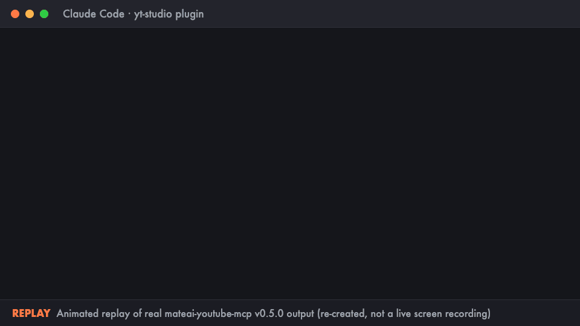

#  MateAI YouTube MCP: upload, schedule and analyze your channel from Claude & Antigravity

[](https://github.com/mategog/mateai-youtube-mcp/releases/latest)
[](https://glama.ai/mcp/servers/mategog/mateai-youtube-mcp)
[](LICENSE)
[](https://www.youtube.com/@mateai-c6m)

**`mateai-youtube-mcp` (installed as the `yt-studio` plugin) is a free, self-hosted MCP server that lets Claude Code, Claude Desktop and Google Antigravity upload, schedule and analyze videos on your own YouTube channel through Google's official YouTube Data and Analytics APIs.** It runs on your computer, uses the AI subscription you already pay for, and costs $0.



<sub>Animated replay of real v0.5.0 output (re-created, not a live screen recording): a dry run, a wrong date caught by a warning, then a real scheduled upload.</sub>

Ask your AI things like:

> "Upload `exports/short.mp4` with this cover, write the title, description and hashtags, and schedule it for tomorrow 20:00 CET."
>
> "Which of my Shorts lost viewers in the first two seconds?"

**Contents:** [Why this server](#why-this-server) · [Quick start](#quick-start) · [Try it](#try-it) · [Tools](#tools) · [Safety](#safety-dry-runs-confirmations-and-limits) · [Quota](#youtube-api-quota) · [Privacy](#privacy-what-it-runs-sends-and-fetches) · [TikTok](#tiktok-optional-experimental) · [Troubleshooting](#troubleshooting) · [License](#license)

## Why this server

- **Built for Shorts.** Viewed vs. swiped away, engaged views, average % viewed and 100-point retention curves per video, so you can see where viewers leave.
- **Upload and schedule in one sentence.** Video, cover, title, description, hashtags, tags, language, synthetic-media disclosure, pinned comment and a future publish time.
- **Nothing goes live by surprise.** Every write has a `dry_run` preview, deleting a video always asks first, and `/yt-safety` lets you add confirmations for uploads, edits and comments. The confirmation box is shown by the plugin, so the AI can't click "yes" for you. See [Safety](#safety-dry-runs-confirmations-and-limits).
- **One-command setup.** `/yt-setup` in Claude Code opens Google's sign-in in your browser; you click Allow. No Google Cloud project needed.
- **Runs only on your machine.** Your login stays in a local file only you can read, and the author receives no data. See [Privacy](#privacy-what-it-runs-sends-and-fetches).
- **$0.** Google's YouTube APIs are free within the daily quota, and hosted creator tools charge a monthly fee to wrap these same APIs.
- **TikTok side by side (optional, experimental).** Compare each Short with the same video on TikTok, and send a Short to your TikTok inbox. Needs your own TikTok developer app in sandbox mode; see [TikTok](#tiktok-optional-experimental).
- **A full creator pipeline.** The plugin bundles research, ideation, packaging and scripting skills next to the MCP tools. See [Bundled skills](#bundled-skills-and-credits).

### Is it the right tool for you?

| You want to… | This server |
|---|---|
| Upload, schedule and edit videos on **your own** channel | Yes |
| Diagnose Shorts retention and swipe-away rate | Yes |
| Read and reply to comments on your videos | Yes |
| Compare YouTube Shorts with TikTok | Experimental: needs your own TikTok sandbox app |
| Get transcripts of **other people's** videos | No: use a transcript MCP server |
| Manage playlists, bulk Reporting API exports, revenue or demographics | No: other YouTube MCP servers cover more of the API |

## Quick start

### Claude Code (recommended)

```bash
claude plugin marketplace add mategog/mateai-youtube-mcp
claude plugin install yt-studio@mateai-youtube-mcp
```

Then type **`/yt-setup`** in Claude Code to connect your channel (needs Claude Code 2.1.287 or newer). It is one sign-in in your browser; see [Easy setup](#easy-setup-yt-setup).

The plugin keeps its state (`.venv`, OAuth client, tokens, `channel_snapshot.json`, `report.html`) in `~/.claude/plugins/data/yt-studio-mateai-youtube-mcp/`, which survives plugin updates.

### Google Antigravity

Clone into your Antigravity plugins folder, restart Antigravity, then run the [setup wizard](#manual-setup-wizard-any-client) from that folder:

```bash
git clone https://github.com/mategog/mateai-youtube-mcp.git \
  ~/.gemini/config/plugins/mateai-youtube
cd ~/.gemini/config/plugins/mateai-youtube && python3 yt_studio.py setup
```

### Claude Desktop and other MCP clients

Clone the repo, run `python3 yt_studio.py setup` once, then add the server to your client's config (`claude_desktop_config.json` for Claude Desktop):

```json
{
  "mcpServers": {
    "mateai-youtube": {
      "command": "python3",
      "args": ["/ABSOLUTE/PATH/TO/mateai-youtube-mcp/mcp_server.py"]
    }
  }
}
```

Any MCP client that runs local (stdio) servers can use this config. Only Claude Code, Claude Desktop and Antigravity are tested.

<details>
<summary><b>Windows (10/11)</b></summary>

The plugin runs on Windows with the same commands; only Python needs one check first.

**1. Make sure `python3` works.** Claude Code and Antigravity start the server as `python3`. Install Python 3.10 or newer from [python.org/downloads](https://www.python.org/downloads/) (the **Python install manager**) or from the Microsoft Store; both add a `python3` command. Then check it in PowerShell:

```powershell
python3 --version
```

It should print `Python 3.x`. If it opens the Microsoft Store or prints "Python was not found", you have the older python.org installer (it only adds `python` and `py`) or no Python yet: install Python with the install manager above, then open **Settings > Apps > Advanced app settings > App execution aliases** and make sure the **Python** aliases are on. Open a new PowerShell window and check again.

**2a. Claude Code.** Install from the marketplace, then run `/yt-setup` inside Claude Code, exactly as on macOS:

```powershell
claude plugin marketplace add mategog/mateai-youtube-mcp
claude plugin install yt-studio@mateai-youtube-mcp
```

`/yt-setup` opens Google's sign-in in your default browser. The plugin's data folder is `%USERPROFILE%\.claude\plugins\data\yt-studio-mateai-youtube-mcp`.

On a Claude Code older than 2.1.287 (no `/yt-setup`), run the wizard by hand:

```powershell
$env:MATEAI_YT_HOME = "$env:USERPROFILE\.claude\plugins\data\yt-studio-mateai-youtube-mcp"
$plugin = Get-ChildItem "$env:USERPROFILE\.claude\plugins\cache\mateai-youtube-mcp\yt-studio" -Directory |
  Sort-Object { [version]$_.Name } | Select-Object -Last 1
python3 "$($plugin.FullName)\yt_studio.py" setup
```

The same `$env:MATEAI_YT_HOME` line works before `python3 ...\tiktok_studio.py setup`. Restart Claude Code afterwards.

**2b. Antigravity.** Clone into your Antigravity plugins folder and restart Antigravity:

```powershell
git clone https://github.com/mategog/mateai-youtube-mcp.git "$env:USERPROFILE\.gemini\config\plugins\mateai-youtube"
```

For the private Studio analytics, run the wizard from that folder: `cd "$env:USERPROFILE\.gemini\config\plugins\mateai-youtube"; python3 yt_studio.py setup`.

**Standalone MCP config.** Use forward slashes or doubled backslashes in JSON, for example `"args": ["C:/Users/you/mateai-youtube-mcp/mcp_server.py"]`.

**What differs from macOS**
- **Login file privacy.** macOS and Linux get `0600` file permissions. Windows has no such modes (`os.chmod` only toggles read-only), so the plugin doesn't pretend: your token and client file are protected by living in your own user profile folder, which Windows by default lets only you, SYSTEM and administrators read. Anyone with an administrator account on the PC can read them, as with any file in your profile.
- **MateAI Studio login sharing** (reusing the desktop app's YouTube login) is macOS-only for now; on Windows the plugin uses its own login from `/yt-setup`.

</details>

<details>
<summary><b>Linux</b> (untested)</summary>

`/yt-setup` auto-opening the Google pages is macOS and Windows only. On Linux, use the [manual wizard](#manual-setup-wizard-any-client) (`python3 yt_studio.py setup`).

</details>

> **Rather skip the Google Cloud setup?** MateAI Studio is a desktop app built on this plugin: you sign in to YouTube with one click, without creating your own Google Cloud project. It's free during early access, and the first testers are invited in small batches. [Join the early-access list →](https://mateaistudio.com/)

## Try it

After setup, ask your AI:

1. "Take a snapshot of my channel and show me the report." (runs `yt_channel_snapshot` and writes `report.html`)
2. "Which of my last 5 Shorts had the highest swipe-away rate, and where did viewers leave?"
3. "Do a dry run: upload `short.mp4` with `cover.png`, title it '…', and schedule it for Friday 18:00 my time."

## Tools

**YouTube**

| Tool | What it does |
|---|---|
| `yt_channel_snapshot` | Fetch channel overview, long-form uploads and Shorts stats, and update `report.html`. |
| `yt_shorts_experiment_table` | Markdown table comparing Shorts retention, swipe-away rate and views. |
| `yt_video_details` | Metadata, 100-point retention curve, drop-off points and traffic sources for an 11-character `video_id`. |
| `yt_upload_draft` | Upload a local MP4/MOV + cover image with full Studio setup (`title`, `description`, `hashtags`, `tags`, `language`, `contains_synthetic_media`, `pinned_comment` and a **`publish_at` schedule**). |
| `yt_update_video` | Update title, description, tags, privacy status, schedule time, thumbnail or the `contains_synthetic_media` disclosure of an existing video; parts you don't change are not re-sent. |
| `yt_post_comment` | Post a top-level comment on a video. |
| `yt_list_videos` | List/search your uploads (private and unlisted included) to find video IDs. |
| `yt_list_comments` | Read top-level comment threads (with replies) on a video. |
| `yt_reply_comment` | Reply publicly to a top-level comment. |
| `yt_delete_video` | Permanently delete a video; refuses unless you pass its exact title. |
| `yt_get_safety_settings` / `yt_set_safety_settings` | Show / choose which actions ask you first. Used by `/yt-safety`. |

**TikTok** (optional and experimental, needs the [TikTok setup](#tiktok-optional-experimental))

| Tool | What it does |
|---|---|
| `tiktok_channel_snapshot` | Fetch your TikTok profile stats and recent videos (views, likes, comments, shares) through TikTok's official API. |
| `tiktok_draft_status` | Check where a video sent with `tiktok_upload_draft` stands (waiting in the inbox, processing, posted, or failed with TikTok's reason). Read-only. |
| `tiktok_upload_draft` | Send a local MP4/MOV to your TikTok app inbox and return the caption to paste, plus a reminder to switch on TikTok's AI-generated label. It does not publish for you. |
| `cross_platform_shorts_table` | Markdown table that pairs each YouTube Short with the same video on TikTok (views, likes, comments, YouTube avg % viewed, TikTok shares). Videos that exist on only one platform get their own row. |

**Dashboard: `/yt-dashboard`** (Claude Code 2.1.287+). Shows or hides a channel card above the prompt: total views, subscribers, video count, and your latest five videos with a viewed-vs-swiped bar. Desktop, VS Code and mobile draw it as a card; the terminal shows a text version. It redraws whenever `yt_channel_snapshot` runs, so the standalone `report.html` is optional.

## Safety: dry runs, confirmations and limits

**Preview before anything goes live.** `yt_upload_draft`, `yt_update_video` and `yt_post_comment` accept `dry_run: true`. They then upload, change and post nothing, need no sign-in, and return exactly what would be sent, with the schedule in your local time and a warning if `publish_at` is in the past or has no timezone. Ask your AI: "Do a dry run of this upload first."

**Choose what asks first: `/yt-safety`.** Claude always asks before **deleting a video**. Type `/yt-safety` to also be asked before uploading videos, changing a video's details, or posting and replying to comments. No files to edit, and you can run it again any time.

When an action asks first, the plugin itself shows a confirmation box with exactly what's about to happen, and nothing happens until you click yes. Claude can't answer that box for you, so text hidden in a viewer's comment can't approve a delete. This needs a client that shows MCP confirmation dialogs (Claude Code 2.1.76 or later). In a client that can't, deleting a video and changing these settings are refused (delete in YouTube Studio instead), and the other actions fall back to Claude asking you in chat, which the plugin can't check.

**Built-in limits (always on, not adjustable).** These back up the MateAI Terms of Service ban on spam-like commenting and protect the daily YouTube quota that all MateAI users share.
- At most **20 comments and replies per hour** and **100 per 24 hours** (an upload's auto-posted comment counts too). The same text (ignoring case and spacing) can be posted at most **twice in 24 hours**, across all videos. When a limit is hit, nothing is posted and Claude is told when posting is allowed again. The count is kept in `comment_log.json` next to `safety.json` (timestamps and a hash of the text, not the text itself).
- When YouTube reports the quota or rate limit is used up (`quotaExceeded` / `rateLimitExceeded`), the plugin stops immediately with a clear message instead of retrying.

## YouTube API quota

A Google Cloud project gets **10,000 free YouTube Data API units per day**, reset at midnight Pacific time. With the built-in client that daily budget is shared by everyone using it; with [your own client](#use-your-own-google-cloud-client-optional-own-quota) it is yours alone. What each action costs, per [Google's quota table](https://developers.google.com/youtube/v3/determine_quota_cost) (checked 2026-11-08):

| Action | Data API calls | Units |
|---|---|---|
| Snapshot, list videos, video details, list comments | `*.list` | 1 per call |
| Upload a video (`yt_upload_draft`) | `videos.insert` | Own bucket of 100 uploads/day, not the 10,000 units |
| + custom cover | `videos.list` (waits for processing) + `thumbnails.set` | 50, plus 1 per processing check (at most 60) |
| + pinned comment | `commentThreads.insert` | 50 |
| Edit a video (`yt_update_video`) | `videos.list` + `videos.update` (+ `thumbnails.set`) | 51 (101 with a new cover) |
| Post a comment / reply | `commentThreads.insert` / `comments.insert` | 50 |
| Delete a video | `videos.list` + `videos.delete` | 51 |

Retention, swipe-away and other analytics come from the YouTube Analytics API, which isn't part of these 10,000 units.

## Easy setup: `/yt-setup`

Type **`/yt-setup`** in Claude Code and it connects the plugin to your YouTube account. You do this once. Everything stays on your computer; only Google sees your sign-in.

**You need:** Claude Code 2.1.287 or newer, this plugin installed, and the Google account that owns your channel.

**1. Type `/yt-setup`.** It answers "Opening your browser…" (or "Already connected." if you are done).

**2. Sign in (your browser opens).** Pick your YouTube account, tick **every box**, click **Allow**. Claude Code then shows **"yt-setup: connected!"** and the "YouTube: not connected" status hint disappears.

That's all. The plugin ships with the Google-verified MateAI Studio sign-in client (`oauth_client.json`), so you don't create a Google Cloud project. `/yt-setup` never sees your Google password.

### Manual setup wizard (any client)

Not using Claude Code 2.1.287+? Run the wizard:

```bash
python3 yt_studio.py setup
```

The wizard:
1. **Creates `.venv` and installs Google's OAuth libraries** if they aren't installed yet.
2. **Starts the YouTube sign-in in your browser** with the built-in client, then opens your `report.html` dashboard.

For the Claude Code plugin on an older Claude Code, point the wizard at the plugin's data folder:

```bash
MATEAI_YT_HOME=~/.claude/plugins/data/yt-studio-mateai-youtube-mcp \
  python3 ~/.claude/plugins/cache/mateai-youtube-mcp/yt-studio/<version>/yt_studio.py setup
```

Replace `<version>` with your installed version (`ls ~/.claude/plugins/cache/mateai-youtube-mcp/yt-studio/`), or run the same command from any clone of this repo. Restart Claude Code afterwards.

### Use your own Google Cloud client (optional, own quota)

You can sign in through your own Google Cloud project instead, for example to have your own API quota. A `client_secret.json` in the plugin's data folder takes priority over the built-in client.

1. In [Google Cloud Console](https://console.cloud.google.com/), create a project and enable **YouTube Data API v3** and **YouTube Analytics API**.
2. Page "Audience": click **Add users** under **Test users**, enter your YouTube email, **Save**.
3. Page "Create OAuth client": **Application type = Desktop app** (not "Web application"), any name, **Create**, then **Download JSON**.
4. Save the file as `google_auth_secret/client_secret.json` in the plugin's data folder (`~/.claude/plugins/data/yt-studio-mateai-youtube-mcp/`), then run `/yt-setup` (delete the `.tokens` folder first if you were already connected).

On Google's sign-in, "Google hasn't verified this app" then appears: click **Advanced**, then **Go to … (unsafe)**; this is your own app. With your own app in "Testing" mode Google expires the sign-in every 7 days.

If the plugin has no built-in client (a clone without `oauth_client.json`), `/yt-setup` and the wizard guide you through these steps: they open the Google pages and pick the downloaded file up from `~/Downloads`.

### Public mode (no login, opt-in)

Public stats for any channel work without API keys, but public page scraping is off by default. Opt in with `--public`, `force_public=true` or `MATEAI_YT_PUBLIC_SCRAPE=1`:

```bash
git clone https://github.com/mategog/mateai-youtube-mcp.git
cd mateai-youtube-mcp
python3 yt_studio.py snapshot --public --handle @mateai-c6m
open report.html

# Markdown table for Shorts A/B style experiments
MATEAI_YT_PUBLIC_SCRAPE=1 python3 yt_studio.py experiment-table --handle @mateai-c6m
```

For your own channel, the official APIs above are the recommended default.

## Privacy: what it runs, sends and fetches

Everything runs on your own computer. The author receives no data. Nothing is sent anywhere except to Google/YouTube (and to TikTok, only if you set up the optional TikTok connection), and to your Claude conversation, which is under Anthropic's own privacy terms (see [PRIVACY.md](PRIVACY.md)).

**The MCP server** (`mcp_server.py`, started by Claude Code as `python3 ${CLAUDE_PLUGIN_ROOT}/mcp_server.py`):
- Calls Google's **YouTube Data API v3** and **YouTube Analytics API v2** with the scopes you approve at sign-in: read-only analytics, and optionally upload, edit metadata and post comments.
- **Public mode (off by default):** fetches public `youtube.com` channel and video pages only when you opt in with `--public`, `force_public=true` or `MATEAI_YT_PUBLIC_SCRAPE=1`.
- `yt_upload_draft` reads the video and cover files whose paths you give it and uploads them to your channel. `yt_update_video` and `yt_post_comment` change your video or post a comment, only when called.
- Writes `channel_snapshot.json` and `report.html` (cached statistics for your own channel) to the plugin data folder.

**The `/yt-setup` command** (a Claude Code mod in `hooks/`):
- Only when the plugin has no built-in client: looks for a `client_secret*.json` in the plugin data folder, your current project and `~/Downloads` (up to 5 folders deep), copies a Desktop-app client into the data folder with `600` permissions, and opens two Google Cloud pages (macOS `open`, Windows `rundll32 url.dll,FileProtocolHandler`). It never prints the file.
- Creates a Python virtual environment in the data folder and runs `pip install -r requirements.txt` (from PyPI: `google-api-python-client`, `google-auth-oauthlib`, `google-auth-httplib2`).
- Starts Google's sign-in in your browser. Your Google password is typed on Google's own page and never reaches this plugin.
- Reads your saved token only to check which permissions it holds.

**Where your login lives:** `~/.claude/plugins/data/yt-studio-mateai-youtube-mcp/` (`.tokens/token.json`, plus `client_secret.json` if you use your own client, both mode `600`; on Windows `%USERPROFILE%\.claude\plugins\data\yt-studio-mateai-youtube-mcp\`, protected by your user profile folder). Delete that folder to remove it, and revoke access at <https://myaccount.google.com/permissions>.

**With the MateAI Studio app (macOS):** if you've connected YouTube in MateAI Studio, the plugin uses that login instead (read from the app's Keychain item `dev.mateai.desktop`, never changed), so one Connect covers both. The first time, macOS asks whether `security` may use that item: choose **Always Allow**. To keep a separate plugin login, set `MATEAI_DESKTOP_LOGIN=off`.

## TikTok (optional, experimental)

Cross-post your Shorts and see how they do on both platforms. This uses TikTok's official, free developer API only: no cookies, no scraping. It never publishes for you; a video lands in your TikTok app inbox and you tap Post yourself. The YouTube tools work the same whether or not you set this up.

**Experimental: you need your own TikTok developer app, in sandbox mode.** Like the YouTube side, the plugin has no shared app: you create one at developers.tiktok.com. Without TikTok's app review, an app only works in its **sandbox**, and only for the TikTok accounts you add there as **target users** (your own account). Status today: stats (`tiktok_channel_snapshot`) are tested through a sandbox app; sending a draft to the inbox through a sandbox app is **not tested yet**.

> "Send `exports/short.mp4` to my TikTok inbox with the caption from `planning/my-short-upload.md`."
>
> "Show my YouTube Shorts next to the same videos on TikTok."

<details>
<summary><b>Connect TikTok, command line and limits</b></summary>

**Connect TikTok (once)**

1. Create an app at [developers.tiktok.com](https://developers.tiktok.com/) and choose the **Desktop** platform.
2. Open the app's **Sandbox** (create one if there is none). Do the next steps in the sandbox.
3. Add the redirect URI `http://127.0.0.1:8765/callback/` (exactly, with the trailing slash).
4. Enable these scopes: `user.info.basic`, `user.info.profile`, `user.info.stats`, `video.list`, `video.upload`.
5. Under **Target users**, add the TikTok account you'll use. Only target users can sign in; any other account gets a `non_sandbox_target` error.
6. Click **Apply changes**. Edits in the sandbox don't take effect until you do.
7. Run the wizard. It asks for the sandbox's Client Key and Client Secret, opens TikTok's sign-in in your browser, and saves the token locally. Keep the wizard running until the sign-in finishes:

```bash
python3 tiktok_studio.py setup
```

If you installed the plugin, point it at the plugin's data folder first, the same way as for the YouTube wizard: `MATEAI_YT_HOME=~/.claude/plugins/data/yt-studio-mateai-youtube-mcp python3 tiktok_studio.py setup`.

**Command line**

```bash
python3 tiktok_studio.py snapshot                                   # profile and recent videos
python3 tiktok_studio.py upload-draft --video exports/short.mp4 \
  --spec planning/my-short-upload.md                                # send to your TikTok inbox
python3 tiktok_studio.py cross-table                                # YouTube Shorts vs TikTok
```

**Good to know**

- **Drafts only, never public posts.** Posting directly needs the `video.publish` scope and TikTok's audit, and TikTok forces posts from unaudited apps to private. The plugin only sends drafts to your inbox (`video.upload`).
- **Captions are pasted by hand.** TikTok's inbox upload cannot take a caption. `tiktok_upload_draft` builds one from your upload spec (title plus the `#hashtags` in the description, `#Shorts` removed) and returns it for you to paste in the app.
- **Switch on the AI-generated label yourself.** If your video uses a synthetic voice or AI visuals, turn on TikTok's AI-generated content toggle in the app before posting. The API cannot set it.
- **Matching is by title.** The comparison table pairs a Short with a TikTok when the title (hashtags ignored) matches the TikTok title or description. Anything else shows up as its own row, with "—" for the missing platform.
- **Only official numbers.** TikTok's API gives views, likes, comments and shares. Retention-style metrics exist for YouTube only.
- **Your data.** The client file is `tiktok_auth_secret/tiktok_client.json` and the login token is `.tokens/tiktok_token.json`, both owner-only (`0600`) and `.gitignore`d. The cache is `tiktok_snapshot.json`, and every `tiktok_channel_snapshot` call also appends a counts row to `tiktok_history.jsonl` so growth can be measured later. Details in [PRIVACY.md](PRIVACY.md).

| Problem | Fix |
| --- | --- |
| "No TikTok OAuth token found" | Run `python3 tiktok_studio.py setup`. |
| "TikTok refresh token expired" | Run `python3 tiktok_studio.py setup` again to sign in. |
| Setup waits, then times out | The browser tab was closed. Rerun setup; it waits 5 minutes for the sign-in. |
| Sign-in page rejects the redirect | The redirect URI in your TikTok sandbox must be exactly `http://127.0.0.1:8765/callback/`. |
| `non_sandbox_target` or a scope error | Add your account under **Target users**, check the scopes, then click **Apply changes** in the sandbox and rerun setup. |
| The wrong TikTok account got connected | The browser was already signed in to another TikTok account and used it without asking. Sign out of TikTok in the browser, then rerun setup. |
| Channel handle is empty | The `user.info.profile` scope is missing. Enable it in your TikTok app and run setup again. |

</details>

## Troubleshooting

<details>
<summary><b>YouTube setup problems and fixes</b></summary>

| Problem | Fix |
| --- | --- |
| It says the file is a **"web" client** | Create a new client and choose **Desktop app**. |
| Browser shows **"Access blocked" / 403 access_denied** | Only with your own Google client: your email is not under **Test users**. Add it, then rerun `/yt-setup`. |
| **"Login did not finish"** | The tab was closed early or a box was not ticked. Rerun `/yt-setup`. |
| **"yt-studio plugin is not installed"** | Run `claude plugin install yt-studio@mateai-youtube-mcp`. |
| **"Could not install the Google libraries"** | Install Python 3 (python.org) and check your internet connection. |
| **Nothing happens** | Hooks may be off (`disableAllHooks`). `/yt-setup` is a hook-based mod. |
| Asked to log in again after about a week, or "Your YouTube login expired" | Only with your own Google client: Google expires sign-ins after 7 days for an app in "Testing" status with an external user type ([Google's OAuth docs](https://developers.google.com/identity/protocols/oauth2#expiration)). Rerun `/yt-setup`. Whether publishing the app on the Audience page avoids this is **[unconfirmed]**: Google's page doesn't say. Trade-off: moving from "Testing" to "In production" may stop the 7-day expiry **[unconfirmed]**, but sign-in then shows Google's "Google hasn't verified this app" warning. |
| Start over | Delete `~/.claude/plugins/data/yt-studio-mateai-youtube-mcp/.tokens`, then rerun `/yt-setup`. |

</details>

## Bundled skills and credits

The plugin ships the MCP server together with a YouTube strategy and creator skill suite, so your AI can go from niche research and hook writing to live Studio scheduling:

- **Live YouTube Studio execution and analytics** (the MCP tools above, `report.html` dashboard and `setup` wizard): built by **[MateAI (`@mateai-c6m`)](https://www.youtube.com/@mateai-c6m)**.
- **Production pipeline skills** (`yt-research`, `yt-ideation`, `yt-brief`, `yt-packaging`, `yt-outline`, plus the `/yt-pipeline` command and `yt-scraper`, `channel-analyzer`, `idea-validator` agents): created by **[Jeremy Longshore (`@jeremylongshore` / Intent Solutions)](https://github.com/jeremylongshore/tons-of-skills-marketplace/tree/main/plugins/productivity/youtube-strategy)** (`@intentsolutionsio/youtube-strategy`, MIT).
- **14 creator sub-skills and playbooks** (`audit`, `seo`, `script`, `hook`, `thumbnail`, `strategy`, `calendar`, `shorts`, `analyze`, `repurpose`, `monetize`, `competitor`, `metadata`, `ideate`): created by **[Daniel Agrici (`@AgriciDaniel`)](https://github.com/AgriciDaniel/claude-youtube)** (`claude-youtube`, MIT).
- **Chapters, comment replies and title lint** (`yt-chapters`, `yt-comment`, `yt-title-lint`): from **[Jake Schincariol (`@Jakeschincariol`)](https://github.com/Jakeschincariol/youtube-agent-skill)** (`youtube-agent-skill`, MIT). `yt-chapters` builds YouTube-valid chapters from an `.srt`/`.vtt`/Whisper transcript, `yt-comment` triages comments and drafts replies, and `yt-title-lint` checks a title and thumbnail as one pairing (renamed from `yt-package`). All three only write drafts; publishing stays with you or the MCP tools. They read an optional voice profile at `~/.claude/youtube/voice.md`.

## Support

If this saved you from paying for a monthly creator tool:
- **Star the repo** so other creators can find it.
- **Sponsor on GitHub:** [github.com/sponsors/mategog](https://github.com/sponsors/mategog)
- **Subscribe on YouTube:** [MateAI (@mateai-c6m)](https://www.youtube.com/@mateai-c6m): real AI build-logs, measured costs, no hype.
- **Buy Mate a Coffee:** [buymeacoffee.com/mateai](https://buymeacoffee.com/mateai)

## License

Licensed under **Apache License 2.0 with Commons Clause Restriction v1.0** ([LICENSE](LICENSE)). This is a *source-available* license, not an OSI open-source one; GitHub may label the repository "Apache-2.0" because of the base text.

- **Free for creators and developers:** you may use, modify and share this tool for your own YouTube channels (including monetized channels).
- **No commercial resale or paid SaaS wrapping:** you may **not** sell this software, bundle it into a paid product, or host it as a paid/managed MCP service without a commercial license from MateAI.
